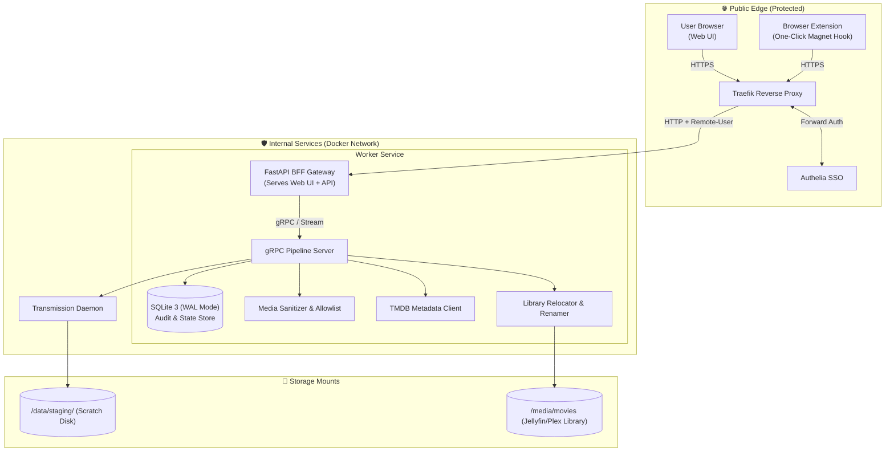
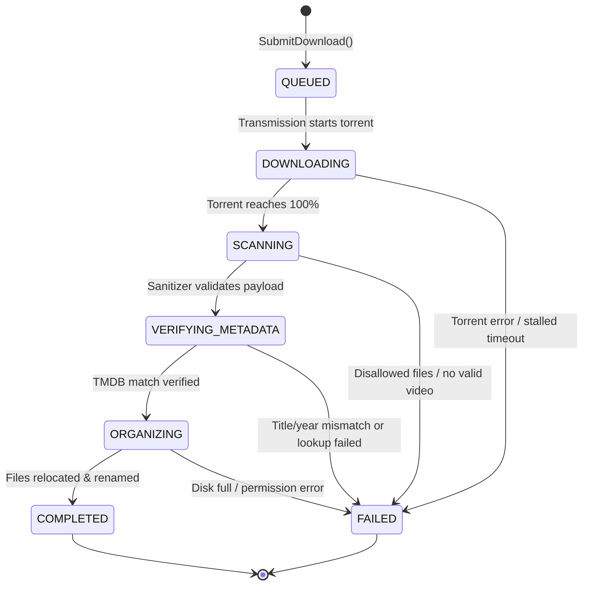

# 🏛️ MagNetFlix — Architecture & System Design

MagNetFlix uses a **Backend-For-Frontend (BFF)** pattern paired with an internal **gRPC Worker** pipeline service to decouple public web endpoints from disk I/O and media processing.

---

## 📐 High-Level Architecture



> For foundational design trade-offs and decisions, see [ADR 001: Pipeline Safety, Storage Boundaries, and BFF Dual-Client Architecture](adr/001-pipeline-safety-and-bff-dual-client.md).

---

## 🔄 Job State Machine & Lifecycle Rules

The pipeline worker operates strictly as a finite state machine with terminal failure handling.



### Transition & Failure Invariants
1. **Linear Progression**: `QUEUED` ➔ `DOWNLOADING` ➔ `SCANNING` ➔ `VERIFYING_METADATA` ➔ `ORGANIZING` ➔ `COMPLETED`.
2. **Terminal Failure**: Any failure at any phase transitions the job directly to `FAILED` with a populated `error_message`.
3. **Stalled Download Timeout**: If a torrent achieves zero progress (0 bytes downloaded or unresolved magnet metadata) for 15 consecutive minutes, the job transitions to `FAILED` with reason `"Download stalled: no seeds or metadata timeout"`.
4. **Crash & Restart Recovery**: Upon worker startup, any orphaned non-terminal jobs (`QUEUED`, `DOWNLOADING`, `SCANNING`, `VERIFYING_METADATA`, `ORGANIZING`) in the SQLite database are automatically transitioned to `FAILED` with reason `"Worker restarted during execution"`. Retrying requires a new submission.
5. **Duplicate Rejection (Idempotency)**:
   - A submission is rejected if a non-terminal job for the same `imdb_id` is currently active in the database.
   - A submission is rejected if `/media/movies/*[imdbid-{imdb_id}]` already exists in the destination library.

---

## 🛡️ Security & Media Sanitizer Specification

The sanitizer enforces a strict file-system boundary before files are touched or moved:

1. **Path Traversal & Symlink Check**: Rejects any archive or torrent payload containing symbolic links, hard links, or paths escaping the staging root (`..`).
2. **File Allowlist**:
   - **Allowed Video**: `.mkv`, `.mp4`, `.avi`, `.webm`
   - **Allowed Subtitles**: `.srt`, `.vtt`, `.sub`, `.ass`
   - **Forbidden / Quarantine**: `.exe`, `.bat`, `.cmd`, `.sh`, `.scr`, `.vbs`, `.lnk`, `.iso`, `.zip`, `.rar`, etc.
3. **Multiple Video Selection (Largest File Rule)**:
   - Files containing `sample` in the filename or with size `< 100MB` are discarded.
   - If multiple video files remain, the **single largest video file** is selected as the primary feature film. A warning is logged listing ignored video files.
   - If 0 eligible video files remain, the job transitions to `FAILED`.

---

## 🎬 Metadata Authority & Verification Criteria

- **Authority**: **The Movie Database (TMDB) API** using the `/find/{imdb_id}?external_source=imdb_id` endpoint.
- **Verification Criteria**:
  - The canonical title and release year are fetched from TMDB.
  - A normalized token comparison is performed between the TMDB movie title/year and the torrent folder name / primary video filename.
  - If there is zero token overlap between the metadata title/year and the torrent name, the job transitions to `FAILED` (`"Torrent payload does not appear to match TMDB metadata"`).

---

## 📂 Storage Paths & Two-Stage Atomic Relocation

- **Canonical Staging Path**: `/data/staging/<job_id>/`
- **Canonical Library Destination**:
  ```text
  /media/movies/<Title> (<Year>) [imdbid-<IMDbID>]/<Title> (<Year>).<ext>
  /media/movies/<Title> (<Year>) [imdbid-<IMDbID>]/<Title> (<Year>).en.srt
  ```
- **Two-Stage Atomic Relocation (Cross-Volume Safe)**:
  1. *Stage 1 (Transfer)*: Validated files are copied from `/data/staging/<job_id>/` to a temporary directory on the library mount: `/media/movies/.staging_<job_id>/` using `shutil.copy2`.
  2. *Stage 2 (Atomic Swap)*: Once copying completes and file integrity is verified, `os.replace` atomically renames `/media/movies/.staging_<job_id>/` to the final `/media/movies/<Title> (<Year>) [imdbid-<IMDbID>]/` directory. This prevents Jellyfin/Plex from indexing partially-copied media.
- **Cleanup**:
  - The scratch directory `/data/staging/<job_id>/` is purged immediately upon successful completion or terminal failure.
  - The torrent session is removed from Transmission daemon via RPC `remove_torrent(id, delete_data=True)` to prevent lingering memory/network leaks.

---

## 🌐 Dual-Client Gateway & Ingestion Contract

The FastAPI BFF acts as a unified gateway serving two distinct frontends:

1. **Hosted Web UI (`addmovie.roadtotech.me`)**:
   - Directly served by the FastAPI application as a single-origin web interface.
   - Embeds interactive movie search (with autocomplete, poster previews, and year badges) and a magnet link submission form.
   - Establishes a Server-Sent Events (SSE) connection (`/api/v1/movies/events`) to stream real-time pipeline status updates without polling.
2. **Companion WebExtension (`magnetflix-extension`)**:
   - Injects magnet link interception on third-party torrent indexers.
   - Submits captured magnet URIs and selected IMDb IDs directly to the BFF.

### Route & Payload Compatibility
To support both the web UI and the browser extension without code divergence:
* **Dual Route Bindings**: The BFF mounts both `POST /api/v1/downloads` (canonical REST) and `POST /download` (extension alias).
* **Validation Aliases**: Pydantic schemas accept payload fields interchangeably:
  * Magnet URI: `magnet_uri` (canonical) or `magnet` (extension)
  * IMDb ID: `imdb_id` (canonical) or `imdbid` (extension)
* **Identity Injection**: The BFF extracts authenticated user identity from the Traefik `Remote-User` header. In local testing or extension environments where SSO headers are absent, a configurable fallback (`local_user`) is applied.

---

## 🔐 Security Boundaries & Health Endpoints

### Authentication Trust Boundary
- The FastAPI BFF trusts `Remote-User` and `Remote-Email` headers **strictly because it is reachable exclusively through the authenticated Traefik reverse proxy**. Direct ingress from outside the Docker network is prohibited.

### Health & Readiness Probes
- **BFF**: `GET /healthz` (Verifies FastAPI liveness + gRPC worker channel connectivity).
- **Worker**: gRPC standard health checking protocol (`grpc.health.v1.Health`) + Transmission RPC ping.
