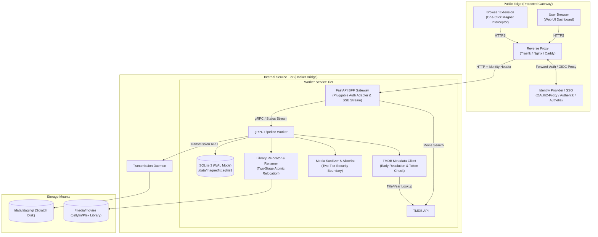
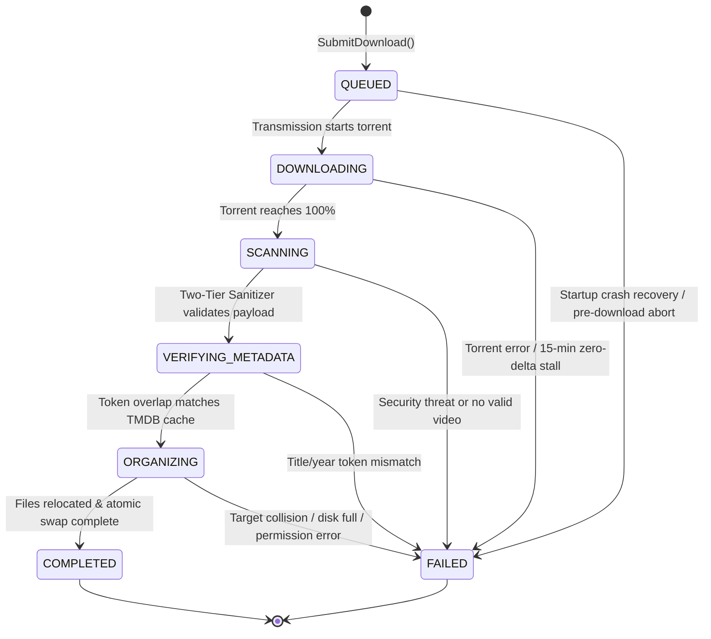

# MagNetFlix — System Architecture & Component Design

MagNetFlix uses a **Backend-For-Frontend (BFF)** pattern paired with an internal **gRPC Pipeline Worker** service to decouple public web endpoints from disk I/O, BitTorrent network activity, and media processing.

---

## High-Level Architecture



### Canonical References
- **Design Decisions (`DEC-1`–`DEC-8`):** [ADR 001: Pipeline Safety & BFF Dual-Client](adr/001-pipeline-safety-and-bff-dual-client.md) · [ADR 002: Pipeline Invariants & Active Reconciliation](adr/002-pipeline-invariants-and-active-reconciliation.md)
- **gRPC & Persistence Contracts:** [`proto/magnetflix/v1/pipeline.proto`](../proto/magnetflix/v1/pipeline.proto) (`SubmitDownload`, `GetJob`, `StreamJobStatus`, `ListJobs`) · [`services/worker/src/worker/db/models.py`](../services/worker/src/worker/db/models.py)
- **Deployment & Roadmap:** [Deployment Topology](deployment.md) · [Implementation Roadmap](roadmap.md)

### Scope, Non-Goals & Operational Limits
- **Scope:** Single-movie acquisition via IMDb ID and BitTorrent `btih` magnet URIs, organized into Jellyfin/Plex naming conventions.
- **v1 Non-Goals:** TV series/multi-episode packs, BitTorrent v2 (`btmh`) magnets, in-flight job cancellation (`CancelDownload`), and direct JWT/JWKS validation inside the BFF.
- **Operational Limits:**
  - Cross-volume relocation requires temporary free space on `/media/movies` equal to the feature film and subtitles being copied (`ORGANIZING`).
  - `/data/staging` and `/data/magnetflix.sqlite3` share `/data` unless mounted separately; pre-check available disk space before accepting or relocating payloads.
  - SQLite WAL supports concurrent readers and a single writer; keep database transactions short-lived and outside long I/O.

---

## Job State Machine & Lifecycle Invariants

The pipeline worker operates as a finite state machine with terminal failure handling.



### Transition & Concurrency Invariants
1. **Nominal Progression**: `QUEUED` -> `DOWNLOADING` -> `SCANNING` -> `VERIFYING_METADATA` -> `ORGANIZING` -> `COMPLETED`.
2. **Terminal Failure**: Any failure at any phase transitions the job directly to `FAILED` with a populated `error_message`. Terminal states (`COMPLETED`, `FAILED`) are immutable.
3. **Active-Job Idempotency (`DEC-2`)**:
   - Magnet `urn:btih:` hashes are normalized to 40-character lowercase hex at ingestion (converting 32-character Base32 hashes); non-`btih` or malformed magnets are rejected.
   - Submissions are rejected (`ALREADY_EXISTS`) if a non-terminal job (`state NOT IN ('COMPLETED', 'FAILED')`) exists in SQLite for the same `imdb_id` **or** the same normalized `info_hash` (preventing two jobs from sharing one Transmission swarm and deleting each other's files).
   - Submissions are rejected if the destination library already contains a matching `[imdbid-{imdb_id}]` directory or the canonical target path.
4. **Stalled Download Timeout (`DEC-6`)**: If a torrent makes **zero progress delta** (unchanged downloaded bytes/progress percentage, or unresolved magnet metadata) for 15 consecutive minutes, the job transitions to `FAILED` with reason `"Download stalled: no seeds or metadata timeout"`.
5. **Active Startup Crash Recovery (`DEC-6`)**: Upon worker startup, an active reconciliation sweep queries all non-terminal jobs:
   - Transitions their SQLite state to `FAILED` with reason `"Worker restarted during execution"`.
   - Connects to Transmission RPC (with bounded startup retry/backoff if Transmission is still initializing) to remove the torrent session via `info_hash` and delete its data.
   - Purges scratch directories `/data/staging/<job_id>/` and `/media/movies/.staging_<job_id>/`.

---

## Security & Media Sanitizer Specification (`DEC-3`)

The sanitizer enforces a two-tier security boundary on untrusted torrent payloads before files are processed (all extension checks are case-insensitive):

### Tier 1: Hard-Fail Security Threats (Immediate Abort to `FAILED`)
- **Filesystem Traversal**: Rejects any file or directory path that resolves outside `/data/staging/<job_id>/` or contains parent-directory traversal segments (`..`).
- **Links & Special Nodes**: Rejects any symbolic links, hard links (`st_nlink > 1`), FIFOs, sockets, or device nodes.
- **Dangerous Extensions**: Rejects any payload containing executable binaries, scripts, or archives/disk images:
  `.exe`, `.bat`, `.cmd`, `.sh`, `.scr`, `.vbs`, `.ps1`, `.lnk`, `.iso`, `.zip`, `.rar`, `.7z`.

### Tier 2: Allowlist Extraction & Safe Discard
- **Allowed Video**: `.mkv`, `.mp4`, `.avi`, `.webm`
- **Allowed Subtitles**: `.srt`, `.vtt`, `.sub`, `.ass`
- **Ignored Non-Media Files**: Non-allowlisted, non-dangerous files (such as `.nfo`, `.txt`, `.jpg`, `.sfv`, or other unrecognized clutter) are ignored during extraction and deleted when the scratch directory is purged.
- **Sample Discard**: Files under `100 MB` or matching `"sample"` as a case-insensitive standalone token / parent `Sample` directory are discarded (avoiding false positives on movie titles containing `"sample"` as a substring).
- **Primary Video Selection**: The single largest remaining video file is selected as the feature film. If 0 eligible video files remain, the job transitions to `FAILED`.

---

## Metadata Authority & Two-Stage Lifecycle (`DEC-4`)

- **Authority**: **The Movie Database (TMDB) API** (`/find/{imdb_id}?external_source=imdb_id`) with bounded HTTP timeouts and retries.
- **Stage 1 (Early Ingestion Resolution)**:
  - Validates standard IMDb ID format (`tt` followed by 7–10 digits) and queries TMDB at submission/queueing time.
  - Verifies the entity is a valid movie (rejects non-existent IDs and TV shows before downloading).
  - Persists canonical `title` and `year` to `DownloadJob`, making them available to live UI dashboards and SSE streams from the start of the job.
- **Stage 2 (Post-Download Token Verification)**:
  - Once the torrent completes, the worker compares cached `(title, year)` tokens against the primary video filename and torrent folder name.
  - Executed against the SQLite database cache with no outbound network calls.
  - Zero token overlap aborts the job to `FAILED` (`"Torrent payload does not appear to match TMDB metadata"`).

---

## Storage Architecture & Two-Stage Atomic Relocation (`DEC-5`)

- **Canonical Staging Path**: `/data/staging/<job_id>/` (local scratch storage).
- **Path & Filename Sanitization**: Before building destination paths, `<Title>` is deterministically sanitized to strip or replace filesystem-illegal and path-breaking characters (`/`, `\`, `:`, `*`, `?`, `"`, `<`, `>`, `|`, control characters, and `..`) and collapse excess whitespace.
- **Canonical Library Destination**:
  ```text
  /media/movies/<SanitizedTitle> (<Year>) [imdbid-<IMDbID>]/<SanitizedTitle> (<Year>).<ext>
  /media/movies/<SanitizedTitle> (<Year>) [imdbid-<IMDbID>]/<SanitizedTitle> (<Year>).en.srt
  /media/movies/<SanitizedTitle> (<Year>) [imdbid-<IMDbID>]/<SanitizedTitle> (<Year>).en.forced.srt
  /media/movies/<SanitizedTitle> (<Year>) [imdbid-<IMDbID>]/<SanitizedTitle> (<Year>).ja.ass
  ```
- **Two-Stage Atomic Relocation (Cross-Volume Safe)**:
  1. *Pre-check & Transfer Stage*: Verify sufficient free space on `/media/movies` and verify the destination directory does not already exist. Copy validated video and subtitles across volumes from `/data/staging/<job_id>/` to temporary staging on the destination mount (`/media/movies/.staging_<job_id>/`). The relocator preserves native allowlisted subtitle formats (`.srt`, `.vtt`, `.sub`, `.ass`), parses language/forced tags from filenames, omits the language tag when none is detected (`<SanitizedTitle> (<Year>).<ext>`), and appends disambiguation indices (`.en.1.srt` or `.1.srt`) to prevent overwrites.
  2. *Atomic Swap*: Atomically rename `.staging_<job_id>/` to the final destination directory on the same target filesystem so media servers (Jellyfin/Plex) never index partially copied media files.
- **Permissions & Cleanup Invariant**:
  - `worker` and `transmission` share aligned non-root `PUID`/`PGID` ownership (`1000:1000` by default) so staging and final library files remain readable by media servers.
  - Scratch `/data/staging/<job_id>/` and any temporary `.staging_<job_id>/` are purged immediately upon `COMPLETED` or `FAILED`.
  - The Transmission session is removed via RPC with `delete_data=True` to reclaim session memory and stop active swarm announcements.

---

## Async Concurrency & Event Streaming (`DEC-7`)

- **Non-Blocking Worker Event Loop & Pool Isolation**:
  - The worker coordinates jobs asynchronously (`grpc.aio`, `aiosqlite`, `httpx`).
  - Blocking operations are offloaded to **separate bounded worker pools** so multi-gigabyte cross-volume file copies cannot starve lightweight `transmission-rpc` progress polling or filesystem scans.
  - Database sessions are short-lived: transactions are committed before long I/O operations and closed immediately.
  - Graceful shutdown handles `SIGINT`/`SIGTERM` by stopping the gRPC server cleanly and draining active workers.
- **In-Memory Pub/Sub Event Streaming**:
  - An internal in-memory pub/sub broker broadcasts progress and state change events to connected `StreamJobStatus` gRPC streams, avoiding SQLite polling loops.
  - Streams subscribe to the broker *before* reading the initial SQLite snapshot (deduplicating by update timestamp/state) and use bounded per-subscriber queues with latest-state coalescing so slow SSE clients never exhaust memory or block healthy streams.

---

## Pluggable Identity Adapter & Dual-Client BFF (`DEC-8`)

- **Provider-Agnostic Identity Adapter (Fail-Closed)**:
  - FastAPI middleware reads the authenticated username from an upstream reverse proxy or OIDC proxy (such as OAuth2-Proxy, Authentik, Authelia, Caddy, or Nginx) via configurable environment variables:
    - `AUTH_ENABLED`: boolean (default: `true`). When `true`, missing or empty identity headers **fail closed with `401 Unauthorized`**.
    - `AUTH_HEADER_USER`: header name (default: `"Remote-User"`, configurable for any proxy/IdP such as `X-authentik-username` or `X-Forwarded-User`).
    - When `AUTH_ENABLED=false` (local development/testing only), identity falls back to `local_user`.
- **Portable Configuration & CORS**:
  - Deployment domains, proxy middlewares, and `CORS_ALLOWED_ORIGINS` (for custom browser extension origins) are environment-driven—zero homelab domains or specific SSO vendors are hardcoded in application logic.
- **Server-Side Movie Search Proxy**:
  - BFF exposes `GET /api/v1/movies/search?q=...`, proxying official TMDB movie search queries server-side using `TMDB_API_KEY` to avoid client-side scraping and browser CORS issues.
- **Dual Client Routes, Health Probes & Schemas**:
  - Supports both the hosted Web UI dashboard and the companion browser extension (`magnetflix-extension`):
    - `POST /api/v1/downloads` (canonical) and `POST /download` (legacy extension compatibility alias).
    - Inbound validation aliases accept `magnet` / `magnet_uri` and `imdbid` / `imdb_id`.
    - Real-time Server-Sent Events (SSE) stream at `GET /api/v1/movies/events` backed by gRPC `StreamJobStatus`.
    - Health probes: BFF `GET /healthz` and Worker standard gRPC health check.
