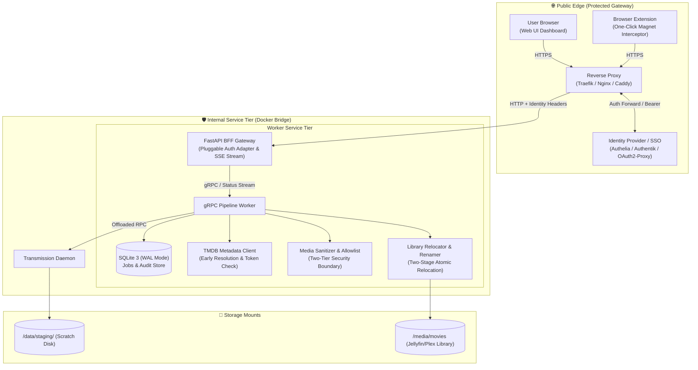
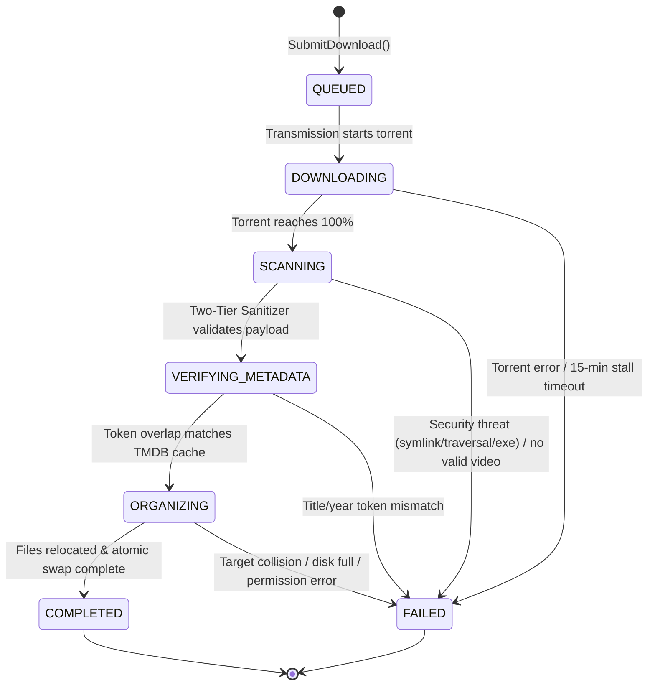

# 🏛️ MagNetFlix — System Architecture & Component Design

MagNetFlix uses a **Backend-For-Frontend (BFF)** pattern paired with an internal **gRPC Pipeline Worker** service to decouple public web endpoints from disk I/O, BitTorrent network activity, and media processing.

---

## 📐 High-Level Architecture



> **Design Decisions & Tradeoffs:**
> - [ADR 001: Pipeline Safety, Storage Boundaries, and BFF Dual-Client Architecture](adr/001-pipeline-safety-and-bff-dual-client.md)
> - [ADR 002: Pipeline Invariants, Two-Stage Metadata, and Active Reconciliation](adr/002-pipeline-invariants-and-active-reconciliation.md)

---

## 🔄 Job State Machine & Lifecycle Invariants

The pipeline worker operates strictly as a finite state machine with terminal failure handling.



### Transition & Concurrency Invariants
1. **Linear Progression**: `QUEUED` ➔ `DOWNLOADING` ➔ `SCANNING` ➔ `VERIFYING_METADATA` ➔ `ORGANIZING` ➔ `COMPLETED`.
2. **Terminal Failure**: Any failure at any phase transitions the job directly to `FAILED` with a populated `error_message`. Terminal states (`COMPLETED`, `FAILED`) are immutable.
3. **Active-Job Idempotency (`DEC-2`)**:
   - Submissions are rejected if a non-terminal job for the same `imdb_id` is currently active in SQLite.
   - Enforced by a partial unique index: `uq_download_jobs_active_imdb_id ON download_jobs (imdb_id) WHERE state NOT IN ('COMPLETED', 'FAILED')`.
   - Submissions are rejected if `/media/movies/*[imdbid-{imdb_id}]` already exists in the destination library.
4. **Stalled Download Timeout (`DEC-6`)**: If a torrent achieves zero progress (0 bytes downloaded or unresolved magnet metadata) for 15 consecutive minutes, the job transitions to `FAILED` with reason `"Download stalled: no seeds or metadata timeout"`.
5. **Active Startup Crash Recovery (`DEC-6`)**: Upon worker startup, an active reconciliation sweep queries all orphaned non-terminal jobs:
   - Transitions their SQLite state to `FAILED` with reason `"Worker restarted during execution"`.
   - Actively signals Transmission via RPC to remove the torrent session via `info_hash` (`delete_data=True`).
   - Purges scratch directories `/data/staging/<job_id>/` and `/media/movies/.staging_<job_id>/`.

---

## 🛡️ Security & Media Sanitizer Specification (`DEC-3`)

The sanitizer enforces a strict two-tier security boundary on untrusted torrent payloads before files are processed:

### Tier 1: Hard-Fail Security Threats (Immediate Abort to `FAILED`)
- **Filesystem Traversal**: Rejects any file or directory path that resolves outside `/data/staging/<job_id>/` or contains relative escaping elements (`..`).
- **Links & Special Nodes**: Rejects any symbolic links (`os.path.islink`), hard links (`st_nlink > 1`), FIFOs, sockets, or device nodes.
- **Dangerous Extensions**: Rejects any payload containing executable binaries, scripts, or disk images:
  `.exe`, `.bat`, `.cmd`, `.sh`, `.scr`, `.vbs`, `.ps1`, `.lnk`, `.iso`, `.zip`, `.rar`, `.7z`.

### Tier 2: Allowlist Extraction & Safe Discard
- **Allowed Video**: `.mkv`, `.mp4`, `.avi`, `.webm`
- **Allowed Subtitles**: `.srt`, `.vtt`, `.sub`, `.ass`
- **Harmless Clutter**: Benign non-media clutter (`.nfo`, `.txt`, `.jpg`, `.sfv`) is safely ignored during extraction and cleaned up when the scratch directory is purged.
- **Sample Discard**: Files containing `sample` in the filename or with size `< 100MB` are discarded.
- **Primary Video Selection**: The single largest remaining video file is selected as the feature film. If 0 eligible video files remain, the job transitions to `FAILED`.

---

## 🎬 Metadata Authority & Two-Stage Lifecycle (`DEC-4`)

- **Authority**: **The Movie Database (TMDB) API** using `/find/{imdb_id}?external_source=imdb_id`.
- **Stage 1 (Early Ingestion Resolution)**:
  - Validates `imdb_id` format (`^tt\d{7,10}$`) and queries TMDB at submission/queueing time.
  - Verifies the entity is a valid movie (rejects non-existent IDs and TV shows before downloading).
  - Persists canonical `title` and `year` to `DownloadJob`, immediately populating live UI dashboards and SSE status frames.
- **Stage 2 (Post-Download Token Verification)**:
  - Once the torrent completes, the worker compares cached `(title, year)` tokens against the primary video filename and torrent folder name.
  - Executed entirely offline from the SQLite database cache without outbound network dependencies.
  - Zero token overlap aborts the job to `FAILED` (`"Torrent payload does not appear to match TMDB metadata"`).

---

## 📂 Storage Architecture & Two-Stage Atomic Relocation (`DEC-5`)

- **Canonical Staging Path**: `/data/staging/<job_id>/` (fast local scratch storage).
- **Canonical Library Destination**:
  ```text
  /media/movies/<Title> (<Year>) [imdbid-<IMDbID>]/<Title> (<Year>).<ext>
  /media/movies/<Title> (<Year>) [imdbid-<IMDbID>]/<Title> (<Year>).en.srt
  /media/movies/<Title> (<Year>) [imdbid-<IMDbID>]/<Title> (<Year>).en.forced.srt
  /media/movies/<Title> (<Year>) [imdbid-<IMDbID>]/<Title> (<Year>).ja.ass
  ```
- **Two-Stage Atomic Relocation (Cross-Volume Safe)**:
  1. *Transfer Stage*: Validated video and subtitles are copied from `/data/staging/<job_id>/` to temporary staging on the destination mount: `/media/movies/.staging_<job_id>/` using `shutil.copy2`. Subtitles preserve native formats (`.srt`, `.vtt`, `.ass`) and parse language/forced tags with disambiguation indices (`.en.1.srt`) to prevent overwrites.
  2. *Pre-check & Atomic Swap*: The worker verifies that `/media/movies/<Title> (<Year>) [imdbid-<IMDbID>]/` does not already exist. It then uses `os.replace` to atomically rename `.staging_<job_id>/` to the final path. This prevents media servers (Jellyfin/Plex) from indexing partially-copied media files.
- **Cleanup Invariant**:
  - Scratch `/data/staging/<job_id>/` and any temporary `.staging_<job_id>/` are purged immediately upon `COMPLETED` or `FAILED`.
  - Transmission session is removed via RPC `remove_torrent(info_hash, delete_data=True)` to prevent memory or tracker leaks.

---

## ⚡ Async Concurrency & Thread Offloading (`DEC-7`)

- **Non-Blocking Worker Event Loop**:
  - The worker coordinates jobs using Python `asyncio` (`grpc.aio`, `aiosqlite`, `httpx`).
  - All blocking operations (multi-gigabyte `shutil.copy2` transfers, synchronous `transmission-rpc` HTTP calls, and recursive filesystem scans) are dispatched to a dedicated bounded `ThreadPoolExecutor(max_workers=4)`.
  - Database sessions are strictly short-lived; transactions are committed before long I/O operations and closed immediately.
- **In-Memory Pub/Sub Event Streaming**:
  - An internal `asyncio.Queue` pub/sub broker broadcasts progress and state change events to connected `StreamJobStatus` gRPC streams without polling SQLite in tight loops.
  - Graceful shutdown handles `SIGINT`/`SIGTERM` via `server.stop(grace=5)`.

---

## 🌐 Pluggable Identity Adapter & Dual-Client BFF (`DEC-8`)

- **Pluggable Identity Adapter**:
  - FastAPI middleware reads authenticated identity from upstream reverse proxies via configurable environment variables:
    - `AUTH_ENABLED`: boolean (default: `true`; if `false`, defaults to `local_user` for offline/local development).
    - `AUTH_HEADER_USER`: header name (default: `"Remote-User"`, configurable for Authentik, OAuth2-Proxy, etc.).
    - `AUTH_HEADER_EMAIL`: header name (default: `"Remote-Email"`).
- **Server-Side Movie Search Proxy**:
  - BFF exposes `GET /api/v1/movies/search?q=...` proxying official TMDB movie search queries server-side using `TMDB_API_KEY`.
  - Eliminates client-side scraping of undocumented APIs and prevents browser CORS issues.
- **Dual Client Routes & Schemas**:
  - Supports both the hosted Web UI dashboard and the companion browser extension (`magnetflix-extension`):
    - `POST /api/v1/downloads` (canonical) and `POST /download` (extension alias).
    - Pydantic validation aliases accept `magnet` / `magnet_uri` and `imdbid` / `imdb_id`.
    - Real-time Server-Sent Events (SSE) route at `GET /api/v1/movies/events`.
