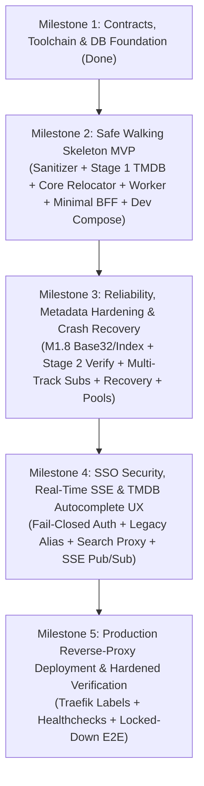

# 🗺️ MagNetFlix — MVP-First Implementation Roadmap

This roadmap organizes **MagNetFlix** using an **MVP-first vertical slice strategy**: deliver a safe, usable local movie downloader as early as Milestone 2 (**Safe Walking Skeleton MVP**), then layer reliability hardening, SSO/SSE/autocomplete polish, and production reverse-proxy deployment in Milestones 3–5 without losing any architectural requirements (`DEC-1`–`DEC-8`).

---

## 🎯 Milestones Dependency Graph

---

## 📌 Milestone 1: Contracts, Toolchain & Database Hardening (`Complete`)
- **Objective:** Fix broken gRPC stub imports, ensure 100% reproducible offline container builds, eliminate the active `imdb_id` deduplication race, and establish database schema invariants.
- **Dependencies:** None.
- **Requirements Satisfied:** `REQ-1`, `REQ-2`.
- **Status:** Complete (`6/6` Gitea issues closed in Milestone `#13`). Former `M1.8` (`Base32 btih info_hash` normalization + Alembic migration `003` + `uq_download_jobs_active_info_hash`) is resequenced to `M3.1` so Milestone 1 closes cleanly and M2 enforces `urn:btih:<40-hex>` validation in `SubmitDownload` until `M3.1` lands.
- **Work Items:**
  - [x] `M1.1`: Create `services/contracts` workspace package (`pyproject.toml`, `module-name = "magnetflix"`).
  - [x] `M1.2`: Reconfigure `buf.gen.yaml` to output stubs into `services/contracts/src`; generate and track stubs + `docs/api_spec.md` in Git (`DEC-1`).
  - [x] `M1.3`: Update dependencies in `services/worker` and `services/bff` to include `magnetflix-contracts = { workspace = true }`.
  - [x] `M1.4`: Update `pyproject.toml` to include `tests/` in `pyright`, remove exclusions that masked broken imports, and add `test:` target to `Makefile`.
  - [x] `M1.5`: Update `services/worker/Dockerfile` and `services/bff/Dockerfile` to copy `services/contracts`, and include `alembic.ini` and `alembic/` in the Worker image.
  - [x] `M1.6`: Create Alembic migration `002_add_info_hash_and_partial_unique_index.py` adding `info_hash` column and `uq_download_jobs_active_imdb_id` index (`DEC-2`).
  - [x] `M1.7`: Update `DownloadJob` model and add unit tests in `tests/test_db.py` verifying duplicate active insertion rejection.
- **Verifiable Exit Criteria:**
  - `uv run python -c "from magnetflix.v1 import pipeline_pb2, pipeline_pb2_grpc"` succeeds with 0 errors.
  - `uv run ruff check .` and `uv run pyright` pass cleanly across the entire workspace including contracts and tests.
  - `uv run pytest` passes all contract and database tests.

---

## 📌 Milestone 2: Safe Walking Skeleton MVP (Local End-to-End Pipeline)
- **Objective:** Deliver a working, torrent-safe local vertical slice: submit a magnet URI + IMDb ID in a browser UI, download via Transmission, enforce Two-Tier Sanitizer security checks, resolve TMDB movie metadata, atomically publish into `/media/movies/<Title> (<Year>) [imdbid-<IMDbID>]/`, and poll live job progress.
- **Dependencies:** Milestone 1.
- **Requirements Satisfied:** `REQ-3`, `REQ-4` (Stage 1), `REQ-5` (Core), `REQ-6`, `REQ-7` (Core), `REQ-8`, `REQ-9` (Core API/UI), `REQ-11` (Local Dev Slice).
- **Explicit Deferrals to Post-MVP:** Stage 2 filename token-overlap verification (`M3.2`), Base32 `btih` normalization + `uq_download_jobs_active_info_hash` (`M3.1`), multi-track subtitle language/forced tag parsing (`M3.3`), 15-min stall timeout + startup active reconciliation + dedicated relocation pool (`M3.4`), standard gRPC health check (`M3.5`), SSO middleware enforcement + legacy `POST /download` + TMDB search autocomplete + SSE pub/sub (`M4`), and Traefik production Compose (`M5`).
- **Work Items:**
  - [ ] `M2.1`: **Two-Tier Media Sanitizer** (`services/worker/src/worker/sanitizer.py` & `tests/test_sanitizer.py`) adhering to `DEC-3`:
    - Export `scan_staging_dir(staging_dir: Path, min_video_bytes: int | None = None) -> SanitizedPayload` (default threshold from `MIN_VIDEO_BYTES`, fallback `100_000_000` bytes).
    - Traverse with `os.walk(staging_dir, followlinks=False)` and run security checks across the **entire tree before** sample discard (including inside `Sample/` folders): reject path escape (`..`), reject *all* symlinks and special nodes (FIFO/socket/device), reject hard links (`st_nlink > 1` on regular files `S_ISREG` only), and hard-fail on dangerous extensions case-insensitively (`.exe`, `.bat`, `.cmd`, `.sh`, `.scr`, `.vbs`, `.ps1`, `.lnk`, `.iso`, `.zip`, `.rar`, `.7z`).
    - Safely ignore unlisted clutter (`.nfo`, `.txt`, `.jpg`, `.sfv`).
    - Discard sample files (`sample`/`samples` directory components or case-insensitive `\bsample\b` filename stem) and video files `< min_video_bytes`; **never** size-filter subtitles.
    - Select largest qualifying video (`.mkv`, `.mp4`, `.avi`, `.webm`) and deterministically sorted allowlisted subtitles (`.srt`, `.vtt`, `.sub`, `.ass`), or raise an explicit domain error if no qualifying video remains.
  - [ ] `M2.2`: **Stage 1 TMDB Metadata Client & Core Atomic Relocator** (`services/worker/src/worker/metadata.py`, `services/worker/src/worker/relocator.py`, `tests/test_metadata.py`, `tests/test_relocator.py`) adhering to `DEC-4` (Stage 1) & `DEC-5` (Core):
    - `TmdbClient`: validate `TMDB_API_KEY` lazily at call time (raising explicit config error if missing, keeping module imports test-safe), validate `^tt\d{7,10}$`, call TMDB v3 `GET /find/{imdb_id}?external_source=imdb_id&api_key=...` via `httpx.AsyncClient` (`TMDB_BASE_URL` default `https://api.themoviedb.org/3`, `10s` timeout, max 2 retries on `5xx`/network errors), require non-empty `movie_results` (rejecting TV/missing), and extract `MovieMetadata(title, year, imdb_id, tmdb_id)` requiring a valid 4-digit `release_date` year.
    - `relocator.py`: `sanitize_title(title)` replacing forbidden/control chars (`/ \ : * ? " < > | \x00-\x1f \x7f`) and `..` with spaces, collapsing whitespace, and stripping leading/trailing dots/spaces (failing if empty); ensure `MEDIA_DIR` exists, scan `MEDIA_DIR` for existing `*[imdbid-<IMDbID>]*` or exact canonical target `<SanitizedTitle> (<Year>) [imdbid-<IMDbID>]` (`DEC-2`), verify `shutil.disk_usage(MEDIA_DIR).free >= total_bytes * 1.05`, stage into `<MEDIA_DIR>/.staging_<job_id>/` (cleanup in `finally:`), name `<SanitizedTitle> (<Year>).<ext>` (deterministic `.1`, `.2` suffixes on same-extension subtitle collisions), and atomically commit via `os.replace`.
  - [ ] `M2.3`: **Transmission Client, Minimal Pipeline Coordinator & Worker gRPC Server** (`transmission.py`, `pipeline.py`, `service.py`, `main.py`, `tests/test_transmission.py`, `tests/test_pipeline.py`, `tests/test_grpc_service.py`):
    - `TransmissionClient`: instantiate `transmission_rpc.Client` lazily per operation inside `asyncio.to_thread` (`TRANSMISSION_HOST`, `TRANSMISSION_PORT`, optional `TRANSMISSION_USER`/`TRANSMISSION_PASS`); provide `add_torrent(magnet_uri, download_dir) -> str`, `get_progress(info_hash) -> TorrentProgress(progress_pct, download_rate_bytes, is_finished, status, error_message)`, and `remove_torrent(info_hash, delete_data=True)` (failing fast if `torrent.error != 0` or missing).
    - `PipelineCoordinator`: `SubmitDownload` validates `urn:btih:<40-hex>` (rejecting Base32/non-btih magnets with `INVALID_ARGUMENT` until `M3.1`), checks active `imdb_id`/`info_hash` duplicates and existing library `[imdbid-...]` directory (`ALREADY_EXISTS`), resolves Stage 1 TMDB metadata (`NOT_FOUND`/`INVALID_ARGUMENT`/`UNAVAILABLE`), persists `QUEUED` job, and spawns a tracked `asyncio.Task` to run `QUEUED -> DOWNLOADING -> SCANNING -> VERIFYING_METADATA` (MVP pass-through) `-> ORGANIZING -> COMPLETED` (or `FAILED`), polling every `POLL_INTERVAL_SECONDS` (default `2.0`), offloading scan/relocate via `asyncio.to_thread`, updating SQLite via short-lived sessions, and cleaning up Transmission torrent + `<STAGING_DIR>/<job_id>` in `finally:`.
    - `PipelineServiceServicer` & `worker/main.py`: implement `SubmitDownload`, `GetJob` (omitting empty `completed_at` timestamps for unfinished jobs), `ListJobs` (integer offset `page_token` default `"0"`, `page_size` default `20` clamped `1..100`, ordered by `created_at DESC, id DESC`, optional `state_filter`), and return `UNIMPLEMENTED` for `StreamJobStatus`; serve on `WORKER_GRPC_PORT` (default `50051`) with graceful `SIGTERM`/`SIGINT` shutdown.
  - [ ] `M2.4`: **Minimal FastAPI BFF, Polling Web UI, Local `docker-compose.yml` & Live Torrent E2E** (`services/bff/src/bff/grpc_client.py`, `main.py`, `services/bff/src/bff/templates/index.html`, `docker-compose.yml`, `tests/test_bff_routes.py`):
    - BFF app keeps `AUTH_ENABLED` defaulting to `true` (`DEC-8`, returning `401` on `/api/*` when enabled without `AUTH_HEADER_USER`), using `local_user` only when `AUTH_ENABLED=false` is explicitly configured in local Compose; resolves templates via `Path(__file__).resolve().parent / "templates"` to match `services/bff/Dockerfile`.
    - Routes: `GET /healthz` (`{"status": "ok"}`), `POST /api/v1/downloads` (`201 Created`, `{imdb_id, magnet_uri}` $\rightarrow$ `{job_id, message}`), `GET /api/v1/downloads` (`{"jobs": [...], "next_page_token": "..."}`), `GET /api/v1/downloads/{job_id}`, and `GET /` polling HTML form every `3s`; explicit gRPC $\rightarrow$ HTTP error mapping (`ALREADY_EXISTS` $\rightarrow$ `409`, `NOT_FOUND` $\rightarrow$ `404`, `INVALID_ARGUMENT` $\rightarrow$ `422`, `UNAVAILABLE` $\rightarrow$ `503`).
    - Local `docker-compose.yml`: `transmission` (`healthcheck`, `PUID`/`PGID`, `./data/staging:/data/staging`, `./config/transmission:/config`, `incomplete-dir-enabled` verified `false`), `worker` (`user: "${PUID:-1000}:${PGID:-1000}"`, `depends_on: transmission: condition: service_healthy`, runs `alembic upgrade head && exec python -m worker.main`, canonical env vars `DATABASE_URL=sqlite+aiosqlite:////data/magnetflix.sqlite3`, `STAGING_DIR=/data/staging`, `MEDIA_DIR=/media/movies`, `TMDB_API_KEY`), and `bff` (`8000:8000`, `GRPC_WORKER_HOST=worker:50051`, `AUTH_ENABLED=false`).
    - Document/prepare pre-created `./data/staging`, `./media/movies`, `./config/transmission` owned by `PUID:PGID`, and verify a live `>= 100 MB` legal public-domain torrent completes end-to-end.
- **Verifiable Exit Criteria:**
  - `uv run ruff check .`, `uv run pyright`, and `uv run pytest` pass 100% across `tests/test_contracts.py`, `tests/test_db.py`, `tests/test_sanitizer.py`, `tests/test_metadata.py`, `tests/test_relocator.py`, `tests/test_transmission.py`, `tests/test_pipeline.py`, `tests/test_grpc_service.py`, and `tests/test_bff_routes.py`.
  - `docker compose build && docker compose up -d` starts cleanly and delivers a real public-domain movie into `./media/movies/<Title> (<Year>) [imdbid-<IMDbID>]/`.

---

## 📌 Milestone 3: Reliability, Metadata Hardening & Crash Recovery
- **Objective:** Close remaining `DEC-2`–`DEC-7` safety and operational resilience gaps deferred from the MVP slice.
- **Dependencies:** Milestone 2.
- **Requirements Satisfied:** `REQ-2` (`M1.8`), `REQ-4` (Stage 2), `REQ-5` (Multi-track subtitles), `REQ-7` (Stall timeout, Crash recovery, Executor isolation).
- **Work Items:**
  - [ ] `M3.1`: *(Relocated `M1.8`)* Normalize Base32 `btih` `info_hash` to 40-char lowercase hex (accepting both 32-char Base32 and 40-char hex magnets in `SubmitDownload`) and add partial unique index `uq_download_jobs_active_info_hash` via Alembic migration `003` (`DEC-2`).
  - [ ] `M3.2`: Implement **Stage 2 Offline Token-Overlap Verifier** in `metadata.py` and wire `VERIFYING_METADATA` in `pipeline.py` to fail jobs whose sanitized primary video filename mismatches cached `(title, year)` (`DEC-4`).
  - [ ] `M3.3`: Implement **Multi-Track Subtitle Format & Tag Parser** in `relocator.py` preserving `.srt`, `.vtt`, `.sub`, `.ass` with normalized ISO-639 language + `.forced` tags and deterministic disambiguation indices (`DEC-5`).
  - [ ] `M3.4`: Harden `pipeline.py` with a 15-minute zero-progress-delta stall timeout, startup active reconciliation sweep (failing orphaned non-terminal jobs, removing Transmission torrents with bounded startup retry, purging staging dirs), and a dedicated bounded `ThreadPoolExecutor` isolating heavy relocation copies from RPC/scan offloading (`DEC-6`, `DEC-7`).
  - [ ] `M3.5`: Enable standard gRPC health checking (`grpcio-health-checking`) on the Worker server and add failure-injection tests for stall timeouts, crash recovery, and metadata mismatch rejection.
- **Verifiable Exit Criteria:**
  - Crash recovery + failure-injection suites pass; orphaned staging directories and stalled torrents are deterministically cleaned up.

---

## 📌 Milestone 4: SSO Security, Real-Time SSE & TMDB Autocomplete UX
- **Objective:** Replace MVP polling and dev-only submission with fail-closed SSO enforcement, legacy extension compatibility, TMDB autocomplete search, and live Server-Sent Events streaming.
- **Dependencies:** Milestone 3.
- **Requirements Satisfied:** `REQ-8` (`StreamJobStatus`), `REQ-9`, `REQ-10`.
- **Work Items:**
  - [ ] `M4.1`: Harden **Pluggable Identity Adapter & CORS** in FastAPI BFF (`DEC-8`): enforce fail-closed `401` when `AUTH_ENABLED=true` and `AUTH_HEADER_USER` header is missing/empty (`/healthz` exempt), enforce `CORS_ALLOWED_ORIGINS` allowlist.
  - [ ] `M4.2`: Add legacy extension route compatibility (`POST /download` alongside `POST /api/v1/downloads` with Pydantic `AliasChoices` for `magnet`/`magnet_uri` and `imdbid`/`imdb_id`).
  - [ ] `M4.3`: Implement server-side **TMDB Search Proxy** (`GET /api/v1/movies/search?q=...` with IMDb ID enrichment) and upgrade `services/bff/src/bff/templates/` + `static/` to autocomplete search with poster previews and live progress cards.
  - [ ] `M4.4`: Implement Worker in-memory `asyncio.Queue` **subscribe-before-snapshot coalescing broadcaster** (`StreamJobStatus` RPC, `DEC-7`) and BFF **SSE endpoint** (`GET /api/v1/movies/events`) replacing frontend polling, with full SSE/auth route tests.
- **Verifiable Exit Criteria:**
  - `uv run pytest tests/test_bff_routes.py` validates fail-closed `401`, legacy dual routes, search proxy, and live SSE streaming without CORS errors.

---

## 📌 Milestone 5: Production Reverse-Proxy Deployment & Hardened Verification
- **Objective:** Finalize production Traefik reverse-proxy configuration, container health probes, and hardened end-to-end verification (`docs/deployment.md`).
- **Dependencies:** Milestone 4.
- **Requirements Satisfied:** `REQ-11` (Production Deployment).
- **Work Items:**
  - [ ] `M5.1`: Reconcile production `docker-compose.yml` (or production overlay) matching `docs/deployment.md`: Traefik labels, `proxy_network` external bridge + internal `backend` network isolating Worker, `AUTH_ENABLED=true`, and verified non-root `PUID`/`PGID` bind-mount permissions.
  - [ ] `M5.2`: Add Docker `HEALTHCHECK` directives (`/healthz` on BFF, gRPC health probe on Worker) and audit multi-stage image builds.
  - [ ] `M5.3`: Execute full production E2E verification: SSO header auth $\rightarrow$ TMDB autocomplete $\rightarrow$ Transmission download $\rightarrow$ Two-Tier Sanitizer $\rightarrow$ Stage 2 token check $\rightarrow$ Multi-track atomic relocation $\rightarrow$ Live SSE completion + restart crash-recovery drill.
- **Verifiable Exit Criteria:**
  - Fresh `docker compose build` succeeds with zero errors, container health checks stay `healthy`, and full hardened E2E lifecycle passes under `AUTH_ENABLED=true`.
