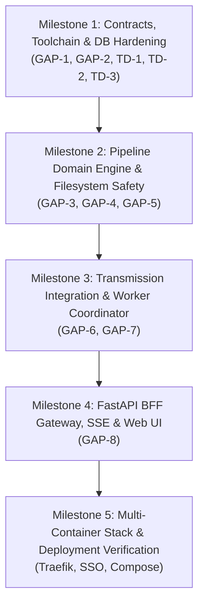

# 🗺️ MagNetFlix — Reconciled Implementation Roadmap

This roadmap breaks down the completion of **MagNetFlix** into clear, dependency-ordered milestones. Each milestone includes explicit prerequisites, work items, and verifiable exit criteria.

---

## 🎯 Milestones Dependency Graph

---

## 📌 Milestone 1: Contracts, Toolchain & Database Hardening
- **Objective:** Fix broken gRPC stub imports, ensure 100% reproducible offline container builds, eliminate the active-job deduplication race, and establish database schema invariants.
- **Dependencies:** None.
- **Requirements Satisfied:** `REQ-1`, `REQ-2`.
- **Work Items:**
  - [ ] `M1.1`: Create `services/contracts` workspace package (`pyproject.toml`, `module-name = "magnetflix"`).
  - [ ] `M1.2`: Reconfigure `buf.gen.yaml` to output stubs into `services/contracts/src`; generate and track stubs + `docs/api_spec.md` in Git (`DEC-1`).
  - [ ] `M1.3`: Update dependencies in `services/worker` and `services/bff` to include `magnetflix-contracts = { workspace = true }`.
  - [ ] `M1.4`: Update `pyproject.toml` to include `tests/` in `pyright`, remove exclusions that masked broken imports, and add `test:` target to `Makefile`.
  - [ ] `M1.5`: Update `services/worker/Dockerfile` and `services/bff/Dockerfile` to copy `services/contracts`, and include `alembic.ini` and `alembic/` in the Worker image.
  - [ ] `M1.6`: Create Alembic migration `002_add_info_hash_and_partial_unique_index.py` adding `info_hash` column and `uq_download_jobs_active_imdb_id` index (`DEC-2`).
  - [ ] `M1.7`: Update `DownloadJob` model and add unit tests in `tests/test_db.py` verifying duplicate active insertion rejection.
- **Verifiable Exit Criteria:**
  - `uv run python -c "from magnetflix.v1 import pipeline_pb2, pipeline_pb2_grpc"` succeeds with 0 errors.
  - `uv run ruff check .` and `uv run pyright` pass cleanly across the entire workspace including contracts and tests.
  - `uv run pytest tests/test_db.py` passes all tests including partial unique index verification.

---

## 📌 Milestone 2: Pipeline Domain Engine & Filesystem Safety
- **Objective:** Implement core business logic and security boundary modules: untrusted payload sanitization, metadata verification, and cross-volume publication.
- **Dependencies:** Milestone 1.
- **Requirements Satisfied:** `REQ-3`, `REQ-4`, `REQ-5`.
- **Work Items:**
  - [ ] `M2.1`: Implement Media Sanitizer (`services/worker/src/worker/sanitizer.py`) adhering to `DEC-3`:
    - Hard-fail on symlinks, hard links, `..` traversal, special files, and dangerous extensions (`.exe`, `.bat`, `.sh`, `.iso`, `.zip`).
    - Safely ignore benign clutter (`.nfo`, `.txt`, `.jpg`, `.sfv`).
    - Discard samples (`< 100MB` or containing `sample`); select largest primary video and allowlisted subtitles (`.srt`, `.vtt`, `.ass`).
  - [ ] `M2.2`: Write unit tests in `tests/test_sanitizer.py` verifying all security, allowlist, and sample discard rules.
  - [ ] `M2.3`: Implement TMDB Client & Token Verifier (`services/worker/src/worker/metadata.py`) adhering to `DEC-4`:
    - Early resolution via `GET /find/{imdb_id}?external_source=imdb_id` using `httpx.AsyncClient`.
    - Validates IMDb ID format, validates movie entity type, extracts `(title, year)`.
    - Post-download normalized token comparison between cached `(title, year)` and primary video filename.
  - [ ] `M2.4`: Write unit tests in `tests/test_metadata.py` with mocked TMDB HTTP responses (match, 404, non-movie, mismatch).
  - [ ] `M2.5`: Implement Library Relocator (`services/worker/src/worker/relocator.py`) adhering to `DEC-5`:
    - Multi-track subtitle format preservation (`.srt`, `.vtt`, `.ass`) with language and disambiguation tags.
    - Two-stage copy-and-swap: copy to `/media/movies/.staging_<job_id>/`, pre-check destination directory existence, and atomically swap via `os.replace`.
  - [ ] `M2.6`: Write unit tests in `tests/test_relocator.py` asserting destination file layout and atomic swap error handling.
- **Verifiable Exit Criteria:**
  - `uv run pytest tests/test_sanitizer.py tests/test_metadata.py tests/test_relocator.py` passes 100%.
  - Zero filesystem breakout vulnerabilities possible under synthetic traversal fixtures.

---

## 📌 Milestone 3: Transmission Integration & Worker Coordinator
- **Objective:** Wrap Transmission RPC, coordinate the pipeline finite state machine, implement startup crash recovery, and expose the gRPC service.
- **Dependencies:** Milestone 2.
- **Requirements Satisfied:** `REQ-6`, `REQ-7`, `REQ-8`.
- **Work Items:**
  - [ ] `M3.1`: Implement Transmission RPC Client Wrapper (`services/worker/src/worker/transmission.py`) adhering to `DEC-6`:
    - `add_torrent(magnet_uri, download_dir=/data/staging/<job_id>)`.
    - `get_progress(info_hash)` returning progress percentage and download speed.
    - `remove_torrent(info_hash, delete_data=True)` for terminal cleanup.
  - [ ] `M3.2`: Write unit tests in `tests/test_transmission.py` with mocked RPC client.
  - [ ] `M3.3`: Implement Pipeline Coordinator & State Machine (`services/worker/src/worker/pipeline.py`) adhering to `DEC-6` & `DEC-7`:
    - State progression: `QUEUED` $\rightarrow$ `DOWNLOADING` $\rightarrow$ `SCANNING` $\rightarrow$ `VERIFYING_METADATA` $\rightarrow$ `ORGANIZING` $\rightarrow$ `COMPLETED`.
    - 15-minute stalled torrent timeout.
    - Startup crash recovery: query orphaned jobs, fail DB rows, purge staging directories, remove torrents from Transmission.
    - Dedicated bounded `ThreadPoolExecutor(max_workers=4)` for offloading disk I/O and synchronous Transmission calls.
    - In-memory `asyncio.Queue` broadcaster for real-time status streaming.
  - [ ] `M3.4`: Implement gRPC Server Servicer (`services/worker/src/worker/service.py` & `main.py`) adhering to `pipeline.proto`:
    - Implements `SubmitDownload`, `GetJob`, `ListJobs`, and `StreamJobStatus`.
    - Maps application errors to proper gRPC status codes (`ALREADY_EXISTS`, `NOT_FOUND`, `INVALID_ARGUMENT`).
  - [ ] `M3.5`: Write integration tests in `tests/test_pipeline.py` and `tests/test_grpc_service.py`.
- **Verifiable Exit Criteria:**
  - `uv run pytest tests/test_pipeline.py tests/test_grpc_service.py` passes 100%.
  - Worker process cleanly starts, handles startup reconciliation, and shuts down gracefully with `SIGTERM`.

---

## 📌 Milestone 4: FastAPI BFF Gateway, SSE & Web UI
- **Objective:** Implement the user-facing web gateway, pluggable SSO identity adapter, server-side TMDB search proxy, real-time SSE stream, and single-origin UI.
- **Dependencies:** Milestone 3.
- **Requirements Satisfied:** `REQ-9`, `REQ-10`.
- **Work Items:**
  - [ ] `M4.1`: Implement Pluggable Identity Adapter Middleware in FastAPI (`DEC-8`):
    - Configurable via `AUTH_ENABLED`, `AUTH_HEADER_USER`, `AUTH_HEADER_EMAIL`, with safe dev fallback (`local_user`).
  - [ ] `M4.2`: Implement BFF gRPC Client Wrapper (`services/bff/src/bff/grpc_client.py`):
    - Channels calls to Worker (`SubmitDownload`, `GetJob`, `ListJobs`, `StreamJobStatus`).
  - [ ] `M4.3`: Implement REST Endpoints & Schemas (`services/bff/src/bff/main.py`):
    - Dual route bindings: `POST /api/v1/downloads` and `POST /download` with Pydantic aliases (`magnet`/`magnet_uri`, `imdbid`/`imdb_id`).
    - Server-side TMDB movie search proxy: `GET /api/v1/movies/search?q=...`.
    - Server-Sent Events stream: `GET /api/v1/movies/events`.
  - [ ] `M4.4`: Embed Hosted Web UI (`services/bff/src/bff/templates/` & `static/`):
    - Clean, responsive dashboard (adapted from extension prototype `app.html`/`app.css`).
    - Movie search autocomplete with poster previews, magnet input, and live progress bars.
  - [ ] `M4.5`: Write API tests in `tests/test_bff_routes.py` covering auth extraction, dual routes, search proxy, and SSE streams.
- **Verifiable Exit Criteria:**
  - `uv run pytest tests/test_bff_routes.py` passes 100%.
  - BFF connects to gRPC worker, serves Web UI, and streams live download progress without browser CORS errors.

---

## 📌 Milestone 5: Multi-Container Stack & Deployment Verification
- **Objective:** Deliver production-ready containerization, Docker Compose stack, Traefik integration, and end-to-end slice verification.
- **Dependencies:** Milestone 4.
- **Requirements Satisfied:** `REQ-11`.
- **Work Items:**
  - [ ] `M5.1`: Finalize `services/worker/Dockerfile` and `services/bff/Dockerfile`.
  - [ ] `M5.2`: Author canonical `docker-compose.yml` defining `bff`, `worker`, and `transmission` services, volume mounts (`./data`, `/media/movies`), and internal/external networks.
  - [ ] `M5.3`: Configure health probes: BFF `GET /healthz`, Worker gRPC standard health check.
  - [ ] `M5.4`: Execute end-to-end integration test with a small public domain/legal torrent:
    - Verify full lifecycle: Form submission $\rightarrow$ Transmission download $\rightarrow$ Sanitizer scan $\rightarrow$ Metadata token check $\rightarrow$ Two-stage atomic relocation into Jellyfin/Plex format $\rightarrow$ Live SSE completion update.
- **Verifiable Exit Criteria:**
  - `docker compose build` succeeds with zero errors from a fresh checkout.
  - Full end-to-end vertical slice runs to completion with media appearing in `/media/movies/<Title> (<Year>) [imdbid-<IMDbID>]/`.
